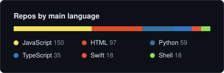

# Angus

**15** · Builder · I ship with AI agents every day

*Tools that make AI agents work together, and traps that catch them misbehaving.*

`Multi-Agent Coding` · `AI Red-Teaming` · `Claude Code Skills` · `Mac Apps` · `Security Tools`

<a href="#agent-tools">Agent Tools</a> · <a href="#security">Security</a> · <a href="#odd-and-fun">Odd and Fun</a> · <a href="#how-i-work">How I Work</a> · <a href="#connect">Connect</a>

  <picture>
    <source media="(prefers-color-scheme: light)" srcset="stats-light.svg" />
    <source media="(prefers-color-scheme: dark)" srcset="stats.svg" />
    
  </picture>
  <picture>
    <source media="(prefers-color-scheme: light)" srcset="languages-light.svg" />
    <source media="(prefers-color-scheme: dark)" srcset="languages.svg" />
    
  </picture>

> [!NOTE]
> **458 repos, 3 public.** Most are still private. I open one up when it has tests, proof and a README worth reading. The ones without a link below are next.

---

## Agent Tools

Things I built because one AI agent on its own is not enough.

| Project | What it does | Proof |
|---|---|---|
| **gambit-lines** | Plans one job five ways, runs real checks, ranks what survives | 219 tests, no dependencies. Checked on 10 real jobs |
| **claudecodex** | Claude and Codex debate who codes, then the other one reviews the diff | 2,171 tests |
| **huddle** | Stops parallel Claude Code terminals editing the same file | A daemon plus hooks that join every terminal and gate each edit |
| **task-split** | One task splits into an animated tree of Claude terminals | One HTML file, demo and live modes |
| **claude-token-forensics** | A local proxy that measures what Claude Code sends and caches | Dated findings, including the ones that came back negative |
| [**dyslexic-mode**](https://github.com/hangryclaude/dyslexic-mode) | A terminal AI that thinks and answers the way a dyslexic reader needs | Runs with `npx`. 44 tests |

## Security

I want to be a world-class AI red-teamer. These are the reps.

| Project | What it does | Proof |
|---|---|---|
| **agent-mirror** | A honeypot that gets a hacking AI agent to report on itself | A recorded run where Claude Code carried the canary into its own report |
| [**api-key-crawler**](https://github.com/hangryclaude/api-key-crawler) | Stops API keys reaching GitHub, even with `--no-verify` | Go. 170 test files. 35.5 ms per commit |
| **redteam-course** | Hands-on labs that attack local models and score every hit | 27 units of runnable labs with canary scoring |

## Odd and Fun

| Project | What it does | Proof |
|---|---|---|
| [**flyby**](https://github.com/hangryclaude/flyby) | Finds where a video was filmed from the planes you can hear in it | Placed the reference clip 26 m from the true spot |
| **stark** | Control your Mac with hand gestures through the webcam | Native Swift and Apple Vision. 25 self-test fixtures |
| **sourcescan** | Tells you the most to pay for a thrift find, from eBay survival curves | Kaplan-Meier with Greenwood intervals. 269 tests |

## How I Work

- I build every day and push every night.
- Every project needs a check that can fail. No check, no claim.
- If a number is in a README, the repo can reproduce it.
- I say what does not work yet.

## Connect

[X @angusbuilds](https://x.com/angusbuilds) · [angusbuilds.com](https://angusbuilds.com)
