

<a href="#agent-tools">Agent Tools</a> · <a href="#security">Security</a> · <a href="#odd-and-fun">Odd and Fun</a> · <a href="#how-i-work">How I Work</a>

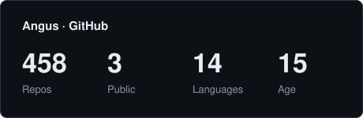

> [!NOTE]
> **458 repos, 3 public.** Most are still private. I open one up when it has tests, proof and a README worth reading. The cards marked SOON are next.

## Agent Tools

Things I built because one AI agent on its own is not enough.

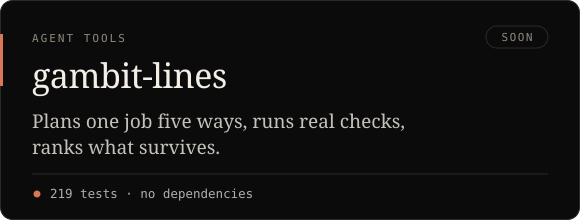
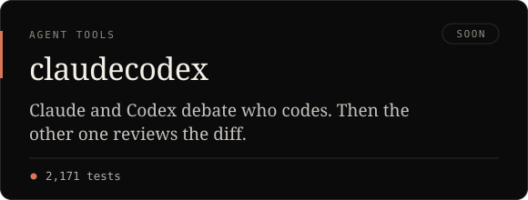
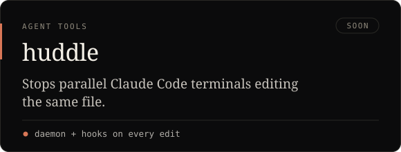
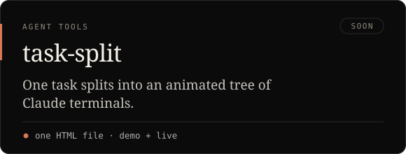
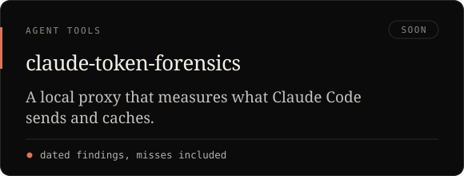
<a href="https://github.com/hangryclaude/dyslexic-mode">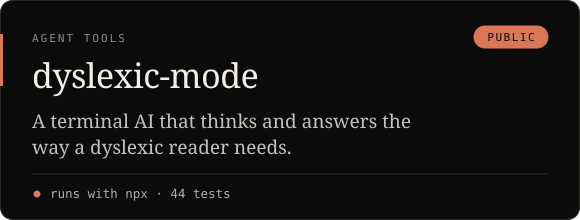</a>

## Security

I want to be a world-class AI red-teamer. These are the reps.

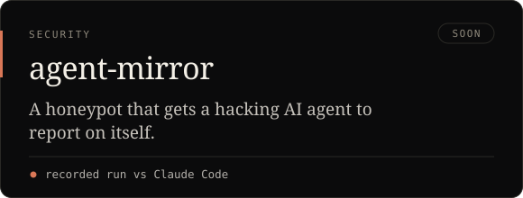
<a href="https://github.com/hangryclaude/api-key-crawler">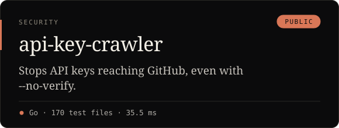</a>
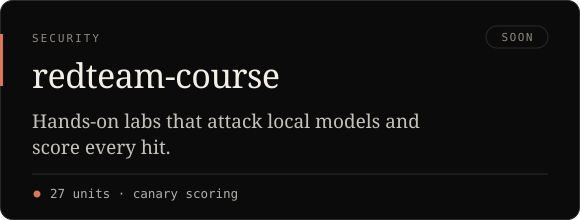

## Odd and Fun

<a href="https://github.com/hangryclaude/flyby">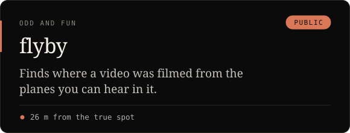</a>
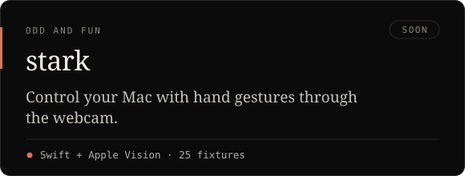
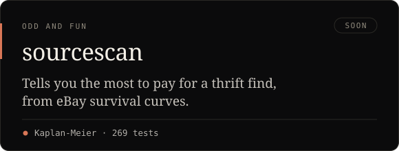

## How I Work

- I build every day and push every night.
- Every project needs a check that can fail. No check, no claim.
- If a number is in a README, the repo can reproduce it.
- I say what does not work yet.

<a href="https://x.com/angusbuilds">X @angusbuilds</a> · <a href="https://angusbuilds.com">angusbuilds.com</a>

